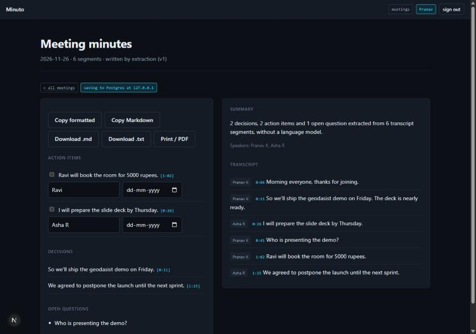

# Minuto

Minutes of meetings from Google Meet, where the words match what was actually said and every decision and task cites the moment it came from.

> **Status: in development.** The pipeline works end to end and is covered by 569 tests. Two things have never met reality: the Chrome extension's reading of Meet's live DOM, and Whisper running on WebGPU inside the extension. Both are built; neither has run in a real call. See [Known gaps](#known-gaps).


*Paste a transcript, get minutes. `geodasist` was corrected to `Geodesis` from the glossary, `by Thursday` resolved to a real date, and every decision and task carries the timestamp it came from.*



*A saved meeting. Owners and due dates are editable and the correction sticks; the task text and its citations are not, because those are what tie each item to something actually said.*

## Why it exists

Most meeting-notes tools optimise word error rate and hide everything else. Minuto tracks four numbers separately, because they fail differently:

| | Why it matters |
|---|---|
| **Word error rate** | The headline, and the least informative alone |
| **Proper-noun recall** | A transcript at 12% WER with every name right makes excellent minutes. One at 6% that renders "Pranav" as "Pranoy" makes minutes nobody trusts |
| **Speaker accuracy** | An action item with the wrong owner is worse than no action item |
| **Hallucinations** | Words invented over silence. Inventions, not mishearings |

The first real scorecard run showed 4.8% word error rate but only 66.7% proper-noun recall — a gap a single aggregate score would have hidden entirely.

## How it works

```
capture ─┬─ tab + mic audio ──→ VAD ──→ Whisper (your GPU) ─┐
         ├─ Meet captions ─────────────────────────────────┤──→ fuse ──→ glossary
         └─ active speaker ────────────────────────────────┘                 │
                                                                             ▼
                        minutes ←── gates ←── summarise ←── extract ←── transcript
```

**Whisper runs on your own machine.** That is the central decision ([docs/ARCHITECTURE.md](docs/ARCHITECTURE.md)): it keeps a top-tier model rather than a cheap one, costs nothing per meeting however many people use it, and makes *your audio never leaves your computer* literally true.

**Captions are not the transcript — they are the speaker channel.** Meet's captions know exactly who is talking but garble the words; Whisper gets the words but cannot tell people apart. Fused, they beat both, with no diarisation vendor.

**Nothing reaches the minutes uncited.** A model only ever sees extracted sentences, never the raw transcript, so it has nothing to invent from. Anything it cites that it was not shown is refused, and any name or number not present in the cited text is flagged rather than asserted.

## Setup

Node 24 or newer, plus [ffmpeg](https://ffmpeg.org/) if you want to transcribe audio, plus Postgres if you want the web app to remember anything.

```powershell
npm install
```

```powershell
npm test
```

If the tests pass you have a working install. Nothing else is required to make minutes from a transcript.

## Using it

### 1. You already have a transcript or rough notes

The fastest path, and the one that needs no audio, no key and no database.

Put the transcript in a text file, one line per utterance:

```
[0:11] Pranav K: So we'll ship the demo on Friday.
[0:26] Asha R: I will prepare the slide deck by Thursday.
Ravi M: Can someone chase the venue invoice?
```

Timestamps are optional, speaker names are optional, and a line with neither continues the line above it — so pasting wrapped text from a chat log works.

```powershell
npm run minutes -- transcript.txt --date 2026-11-25 --glossary "Geodesis, Pranav, Asha, Ravi"
```

You get minutes on stdout with decisions, action items and open questions, each carrying the timestamp it came from.

**Always pass `--glossary`.** It is the single biggest accuracy lever in the whole system: names and project words get corrected (`geodasist` → `Geodesis`), and anything in it counts as known when the gates check what the minutes claim. Thirty seconds of typing buys more than any other setting.

`--date` turns "by Thursday" into a real date. Without it the phrase stays in the text but no due date is set.

### 2. You have a recording

```powershell
npm run transcribe -- recording.m4a --language en --glossary "Geodesis, Pranav, Asha"
```

Any format ffmpeg reads. The first run downloads a Whisper model and caches it, so it is slow once and fast afterwards. The output tells you how fast it ran relative to the audio — below 1.0x means transcription takes longer than the meeting did.

To go straight on to minutes, ask for timestamped lines:

```powershell
npm run transcribe -- recording.m4a --lines > transcript.txt
```

```powershell
npm run minutes -- transcript.txt --glossary "Geodesis, Pranav, Asha"
```

Without `--lines` you get one unbroken paragraph, which `minutes` reads as a single segment — so every citation would point at 0:00. With it, lines break where the speaker paused and the citations land where they should.

Audio alone cannot say *who* spoke, so the lines carry no names. Add them by hand before making minutes if you want owners attributed, or let the extension do it from Meet's captions.

Use `--model onnx-community/whisper-large-v3-turbo` for better accuracy on Hinglish or accented English, at the cost of speed on CPU.

### 3. You are in a Google Meet call

> **Not yet verified in a real call.** The extension is built and its logic is tested, but Meet's live markup has never been read by it. Expect to report what the diagnostic says rather than to get minutes on the first try — see [src/extension/README.md](src/extension/README.md).

```powershell
npm run build:ext
```

```powershell
npm run check:ext
```

Then load `dist/extension` unpacked at `chrome://extensions` with Developer mode on, join a call, switch captions on in Meet, and open the Minuto side panel from the toolbar.

### 4. Letting a model write them

By default minutes are assembled from sentences lifted verbatim out of the transcript. That is accurate but blunt. A language model rewrites them into prose — constrained to those same sentences, so it has nothing to invent from.

Set a key before running anything:

```powershell
$env:MINUTO_API_KEY = "your-key"
```

Gemini by default. `MINUTO_PROVIDER` also accepts `groq` or `openai-compatible` (with `MINUTO_BASE_URL`), and `MINUTO_MODEL` overrides the model. Free tiers are plenty for a few meetings a day.

If the key is missing, the quota is spent, or the model returns nonsense, it falls back to extraction and tells you which path wrote the minutes. It never fails to produce something.

### 5. Saving, editing and sharing

Everything above is one-shot. To keep meetings, correct them and come back to them, run the web app.

```powershell
npm run db:start
```

```powershell
npm run web
```

Open [localhost:3000](http://localhost:3000), create an account, paste a transcript and press **Make minutes**, then **Save and edit**.

On a saved meeting you can fix the owner the pipeline guessed wrong, set a due date, and tick tasks off — the corrections stick. Task text and citations are deliberately not editable, because those are what tie each item to something actually said.

To get the minutes out, use the export buttons:

| Button | Use it for |
|---|---|
| **Copy formatted** | Pasting into Google Docs, Gmail or Word with the table intact |
| **Copy Markdown** | GitHub, Notion, Obsidian |
| **Download .md / .txt** | Files |
| **Print / PDF** | Your browser's print dialog, which includes Save as PDF |

From the CLI the same formats are `--format md`, `txt` or `html`.

Without Postgres the app still runs, but holds everything in memory and says so — nothing survives a restart.

Google sign-in needs an OAuth client you create yourself: [docs/GOOGLE-SIGNIN.md](docs/GOOGLE-SIGNIN.md). Email and password works without it.

### 6. Checking how accurate it is

```powershell
npm run eval
```

Scores the pipeline against the cases in `eval/cases` and reports word error rate, proper-noun recall, speaker accuracy and hallucinations separately.

The one case that ships is synthesised speech and proves nothing about real accuracy. Adding two or three hand-corrected recordings of your own meetings is the highest-value thing you can do for this project — see [eval/README.md](eval/README.md).

## Command reference

| Command | |
|---|---|
| `npm test` | Run the test suite |
| `npm run minutes -- <file>` | Transcript → minutes |
| `npm run transcribe -- <audio>` | Audio → transcript |
| `npm run eval` | Score the pipeline |
| `npm run web` | Web app on localhost:3000 |
| `npm run db:start` / `db:stop` / `db:psql` | Local database |
| `npm run build:ext` / `check:ext` / `watch:ext` | Chrome extension |

Add `--help` to any of the four scripts for its options.

## Layout

| Path | |
|---|---|
| `src/audio` | Decoding, voice detection, windowing |
| `src/asr` | Whisper adapter, window stitching |
| `src/fusion` | Caption normalisation, clock alignment, speaker attribution |
| `src/minutes` | Extraction, summarising, gates, rendering, exports |
| `src/store` | One storage contract, two backends |
| `src/extension` | The Chrome extension |
| `src/eval` | Scoring |
| `web/` | Next.js app |
| `docs/` | Architecture and the accuracy design |

## Known gaps

Worth reading before trusting any of it:

- **Meet's DOM is unverified.** The strategies in `src/extension/meet-dom.ts` are reasoned from Meet's accessibility structure, not captured from a live call. The extension ships a diagnostic that reports what actually matched — see [src/extension/README.md](src/extension/README.md).
- **transformers.js under MV3 is unverified.** WASM paths, the extension CSP and model fetching all have known friction inside an offscreen document.
- **No real accuracy numbers.** The only evaluation case is synthesised speech with hand-written captions. It proves the harness runs and nothing about real accuracy. Hand-corrected recordings of real meetings are the missing piece.
- **Google sign-in needs credentials.** Minuto's side is built and verified; the OAuth client has to be created by hand ([docs/GOOGLE-SIGNIN.md](docs/GOOGLE-SIGNIN.md)). Email and password works meanwhile.
- **No rate limiting or quotas.** Needed before anyone but you uses it.

## Licence

[MIT](LICENSE). Use it, change it, ship it — commercial use included.

## Documentation

- [docs/ARCHITECTURE.md](docs/ARCHITECTURE.md) — the shape of the system and why
- [docs/ACCURACY.md](docs/ACCURACY.md) — the accuracy design, which is the product thesis
- [eval/README.md](eval/README.md) — how scoring works and how to add cases
- [src/extension/README.md](src/extension/README.md) — building and loading the extension
