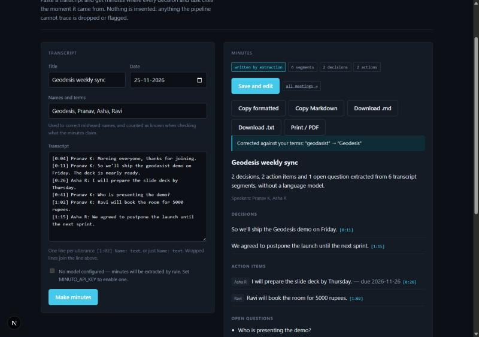

# Minuto

Minutes of meetings from Google Meet, where the words match what was actually said and every decision and task cites the moment it came from.

> **Status: in development.** The pipeline works end to end and is covered by 569 tests. Two things have never met reality: the Chrome extension's reading of Meet's live DOM, and Whisper running on WebGPU inside the extension. Both are built; neither has run in a real call. See [Known gaps](#known-gaps).



*Paste a transcript, get minutes. `geodasist` was corrected to `Geodesis` from the glossary, `by Thursday` resolved to a real date, and every decision and task carries the timestamp it came from.*


*A saved meeting. Owners and due dates are editable and the correction sticks; the task text and its citations are not, because those are what tie each item to something actually said.*

## Why it exists

Most meeting-notes tools optimise word error rate and hide everything else. Minuto tracks four numbers separately, because they fail differently:

| | Why it matters |
|---|---|
| **Word error rate** | The headline, and the least informative alone |
| **Proper-noun recall** | A transcript at 12% WER with every name right makes excellent minutes. One at 6% that renders "Pranav" as "Pranoy" makes minutes nobody trusts |
| **Speaker accuracy** | An action item with the wrong owner is worse than no action item |
| **Hallucinations** | Words invented over silence. Inventions, not mishearings |

The first real scorecard run showed 4.8% word error rate but only 66.7% proper-noun recall — a gap a single aggregate score would have hidden entirely.

## How it works

```
capture ─┬─ tab + mic audio ──→ VAD ──→ Whisper (your GPU) ─┐
         ├─ Meet captions ─────────────────────────────────┤──→ fuse ──→ glossary
         └─ active speaker ────────────────────────────────┘                 │
                                                                             ▼
                        minutes ←── gates ←── summarise ←── extract ←── transcript
```

**Whisper runs on your own machine.** That is the central decision ([docs/ARCHITECTURE.md](docs/ARCHITECTURE.md)): it keeps a top-tier model rather than a cheap one, costs nothing per meeting however many people use it, and makes *your audio never leaves your computer* literally true.

**Captions are not the transcript — they are the speaker channel.** Meet's captions know exactly who is talking but garble the words; Whisper gets the words but cannot tell people apart. Fused, they beat both, with no diarisation vendor.

**Nothing reaches the minutes uncited.** A model only ever sees extracted sentences, never the raw transcript, so it has nothing to invent from. Anything it cites that it was not shown is refused, and any name or number not present in the cited text is flagged rather than asserted.

## Running it

Requires Node 24+, ffmpeg, and Postgres for the web app.

```powershell
npm install
```

```powershell
npm test
```

| Command | What it does |
|---|---|
| `npm run minutes -- transcript.txt` | Transcript → minutes. No API key needed |
| `npm run transcribe -- audio.m4a` | Audio → transcript with Whisper |
| `npm run eval` | Score the pipeline against `eval/cases` |
| `npm run web` | The web app at localhost:3000 |
| `npm run build:ext` | Build the Chrome extension into `dist/extension` |
| `npm run db:start` | Start the local development database |

Optional, for model-written minutes rather than extracted sentences:

```
MINUTO_API_KEY=...        # Gemini by default; also groq or openai-compatible
```

Without a key it falls back to rule-based extraction, which always works and still cites everything.

## Layout

| Path | |
|---|---|
| `src/audio` | Decoding, voice detection, windowing |
| `src/asr` | Whisper adapter, window stitching |
| `src/fusion` | Caption normalisation, clock alignment, speaker attribution |
| `src/minutes` | Extraction, summarising, gates, rendering, exports |
| `src/store` | One storage contract, two backends |
| `src/extension` | The Chrome extension |
| `src/eval` | Scoring |
| `web/` | Next.js app |
| `docs/` | Architecture and the accuracy design |

## Known gaps

Worth reading before trusting any of it:

- **Meet's DOM is unverified.** The strategies in `src/extension/meet-dom.ts` are reasoned from Meet's accessibility structure, not captured from a live call. The extension ships a diagnostic that reports what actually matched — see [src/extension/README.md](src/extension/README.md).
- **transformers.js under MV3 is unverified.** WASM paths, the extension CSP and model fetching all have known friction inside an offscreen document.
- **No real accuracy numbers.** The only evaluation case is synthesised speech with hand-written captions. It proves the harness runs and nothing about real accuracy. Hand-corrected recordings of real meetings are the missing piece.
- **Google sign-in needs credentials.** Minuto's side is built and verified; the OAuth client has to be created by hand ([docs/GOOGLE-SIGNIN.md](docs/GOOGLE-SIGNIN.md)). Email and password works meanwhile.
- **No rate limiting or quotas.** Needed before anyone but you uses it.

## Licence

[PolyForm Noncommercial 1.0.0](LICENSE).

Use it, change it, build on it and share it — for any **noncommercial** purpose. That explicitly covers personal projects, study, research, and use by charities and government bodies. Modifications and forks are welcome.

What it does not cover is commercial use: selling it, selling something built on it, or running it as part of a business.

**This is source available, not open source.** The OSI definition requires no restriction on field of use, so a noncommercial clause disqualifies it, and the same goes for the Free Software Definition. That matters in practice — some companies forbid non-OSI dependencies outright, and some package ecosystems and licence scanners treat the two very differently.

If you want to use Minuto commercially, open an issue and ask. A separate licence costs nothing to grant.

## Documentation

- [docs/ARCHITECTURE.md](docs/ARCHITECTURE.md) — the shape of the system and why
- [docs/ACCURACY.md](docs/ACCURACY.md) — the accuracy design, which is the product thesis
- [eval/README.md](eval/README.md) — how scoring works and how to add cases
- [src/extension/README.md](src/extension/README.md) — building and loading the extension
