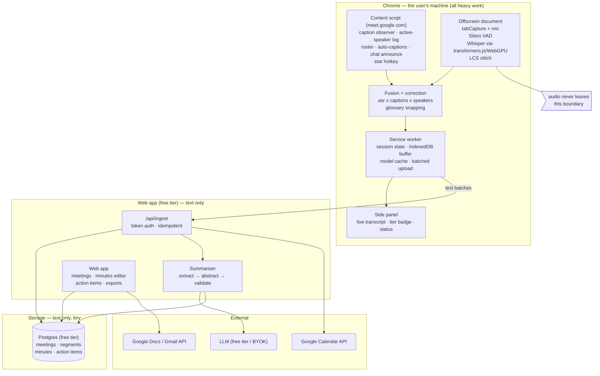

# Minuto — Workflow & Architecture

> Status: design draft, **v0.2** · Target: Google Meet · Public, free, accuracy-first
> Companion doc: [ACCURACY.md](./ACCURACY.md) — the accuracy design, which is the product thesis.

**One line:** Minuto turns a Google Meet call into minutes you can circulate — decisions, action items with owners and dates, and a summary — where the words match what was actually said, and every claim links back to the moment it came from.

---

## 1. Constraints, and the one idea that satisfies all of them

| Constraint | Stated as |
|---|---|
| **C1 Accuracy above all** | The transcript must match the meeting as closely as possible. This is the reason the product exists. |
| **C2 Public** | Anyone can install it. Strangers, not just you. |
| **C3 Dead simple** | Install, join a meeting, get minutes. No configuration, no explaining. |
| **C4 No money** | Free and open resources only. Per-user cost must be ~zero at any scale. |
| **C5 Google Meet** | Meet is the target, not a generic "any platform" tool. |

### The idea: do the expensive work on the user's machine

Run **Whisper client-side in the browser via WebGPU**. The user's own GPU transcribes their own audio.

This resolves C1, C2 and C4 simultaneously, which nothing else does:

- **C1** — you get a top-tier open ASR model, not a cheap one. No accuracy compromise taken for budget.
- **C4** — zero marginal cost per meeting, per user, forever. A server-side ASR bill scales linearly with users you don't charge; this is the only shape that survives being popular.
- **C2** — and it's the strongest trust claim a public recording tool can make: *your audio never leaves your computer.* It also deletes most of your compliance surface.

Your server only ever handles text, which is tiny and cheap. **Audio is never uploaded.**

### What accuracy-first changes from v0.1

v0.1 made Meet's live captions the default source because they're free and carry speaker names. With accuracy as the thesis, captions are no longer good enough to be the *primary* source — they're lossy, mangle names and numbers, and rewrite themselves mid-sentence.

**New model: captions are not the transcript. They are the speaker-identity channel.** Audio+Whisper supplies the words; captions and the active-speaker indicator supply who said them. Fused, the result beats either source and needs no paid diarisation vendor. That fusion is the heart of the system — see [ACCURACY.md §2](./ACCURACY.md).

### Decisions locked (2026-11-26)

| Decision | Choice | Consequence for the build |
|---|---|---|
| **ASR tier default** | **Tier A — `whisper-large-v3-turbo`** | Dev machine is an RTX 3050 6 GB, which runs quantised turbo comfortably above realtime. Tier A is the default and the target; B/C exist only as fallbacks for weaker users. |
| **Launch path** | **GitHub + personal use first**, Store decision later | Phase 3 (OAuth verification, store review, privacy policy) **drops out of the critical path**. See the Calendar consequence below — it's the one that saves you weeks. |
| **Language target** | **Hinglish + Indian English** | Your own recordings become the primary eval data, not AMI. Reinforces tier A, since small/base models degrade sharply on code-switching. |

**The Calendar consequence.** Because you're going GitHub-first, make the Google Calendar lookup **optional from day one**: if there's no connected account, Minuto falls back to reading the meeting title from the Meet tab and the attendee list from the participant roster, with a manual title field. That keeps you off Google's *sensitive-scope* verification path entirely until you choose to launch publicly — and the roster is arguably better data for the glossary than Calendar attendees anyway, because it reflects who actually turned up.

---

## 2. Workflow — what the user actually does

The simplicity requirement (C3) is met by making the *first* run do the heavy lifting invisibly, and every later run require nothing at all.

### First install (once, ~2 minutes)

```
Chrome Web Store → Add to Chrome
      ↓
Sign in with Google  (one click — needed for Calendar titles/attendees)
      ↓
Minuto checks your device, picks a model tier, starts downloading in the
background. You are told: "High-accuracy mode ready in a few minutes —
your first meeting will still be captured."
```

### Every meeting after that (zero actions)

```
Open any meet.google.com link.
      ↓
Minuto badge turns on. It announces itself once in the chat
("Minuto is taking notes"), switches captions on by itself, and captures.
      ↓
Nothing to click. Optional: press Alt+S to star a moment that matters.
      ↓
Call ends  →  Minuto notices and starts processing by itself.
      ↓
~30–90s later: minutes ready. Notification. Open, skim, fix an owner, export.
```

Three decisions that carry the "anyone can use it" requirement:

1. **Auto-enable captions.** Don't instruct the user to turn captions on — click the button for them via the DOM. An instruction is a step; a step is where people drop off.
2. **Auto-detect call end** (participant count, DOM state, tab close). Never rely on the user remembering to press "stop".
3. **Progressive accuracy, never a blocking download.** First meeting is captured and transcribed at whatever tier is ready; audio is kept locally for that session, so once the better model finishes downloading, Minuto silently re-transcribes and upgrades the minutes. The user is never made to wait for a 1 GB download before their first call, and never gets *nothing* because of it.

### End-to-end sequence

```mermaid
sequenceDiagram
    participant U as You (in Meet)
    participant CS as Content script
    participant OFF as Offscreen doc<br/>(audio + Whisper)
    participant API as Minuto API
    participant AI as LLM (summary only)
    participant DB as Postgres (text only)

    U->>CS: Opens meet.google.com/abc-defg-hij
    CS->>API: POST /meetings/start {meetCode}
    API-->>CS: {meetingId, ingestToken, glossary}
    Note over API: Calendar lookup → title, attendees,<br/>agenda → glossary for ASR biasing
    CS->>CS: announce in chat · auto-enable captions
    CS->>OFF: start tabCapture + mic

    loop during the call
        OFF->>OFF: VAD → 30s chunks (5s overlap) → Whisper (WebGPU)
        CS->>CS: observe captions + active-speaker (~400ms)
    end

    U->>CS: call ends (auto-detected)
    OFF->>OFF: final chunks · LCS stitch
    CS->>CS: FUSE asr + captions + speaker log → named, accurate segments
    CS->>CS: glossary correction pass (deterministic)
    CS->>API: POST /segments (text only, idempotent batches)
    API->>AI: extract → abstract → validate citations
    AI-->>API: Minutes JSON + sourceSeqs
    API->>DB: save transcript + minutes
    API-->>U: notify "minutes ready"
    U->>API: fix an owner, export
    Note over OFF: audio discarded locally. Never uploaded.
```

---

## 3. Pipeline

Note where the boundary sits: **S1–S5 run in the browser. Only S6–S7 touch a server.**

| Stage | Name | Where | In | Out |
|---|---|---|---|---|
| **S0** | Session bind + glossary | server | Meet code | meeting row, Calendar metadata, ASR glossary |
| **S1** | Capture | **browser** | live call | audio chunks, caption lines, active-speaker log |
| **S2** | VAD + chunk | **browser** | audio | speech-only 30s windows, 5s overlap |
| **S3** | Transcribe | **browser** | windows | timed words + logprobs (Whisper/WebGPU) |
| **S4** | Stitch + fuse | **browser** | ASR + captions + speaker log | named, accurate segments w/ confidence |
| **S5** | Glossary correction | **browser** | segments | proper nouns snapped to known terms |
| **S6** | Summarise | server | clean transcript | Minutes JSON + citations, entity-grounded |
| **S7** | Deliver | server | Minutes JSON | Markdown / PDF / email / Google Doc |

State machine:

```
capturing → transcribing → fused → uploaded → summarising → ready → delivered
     |            |           |         |           |
     +------------+-----------+---------+-----------+--→ failed(stage, reason)
```

Resumable from the last good stage. A summarisation failure never costs the transcript; a network failure never costs the capture, because capture buffers to IndexedDB.

---

## 4. Components



### Strict responsibilities

- **Extension owns all audio and all ASR.** It never uploads audio. It holds no API keys — only a short-lived, meeting-scoped ingest token, so a compromised or side-loaded copy exposes one meeting's text, nothing more.
- **Server owns summarisation, storage, delivery.** It never sees audio. It only ever handles text, which keeps it inside free tiers indefinitely.
- **Fusion lives client-side**, because that's where all three inputs already are. Doing it server-side would mean uploading the caption and speaker streams separately for no gain.

### Why Meet's DOM dependency is survivable

Caption and active-speaker scraping will break when Google redesigns Meet. Contain it:

- Every selector in **one module**, `src/extension/meet-dom.ts`, with a version-tagged selector table.
- **Startup self-test**: if selectors don't match, the extension logs it, reports an anonymous "selectors broken" ping, falls back to ASR-only with active-speaker-free attribution, and still produces usable minutes. It degrades; it doesn't die.
- Because ASR is the primary source, a DOM break costs you *speaker names*, not the transcript. In v0.1's caption-first design the same break cost you everything. This is a real robustness argument for accuracy-first, independent of accuracy.

---

## 5. Summarisation (server side, the only recurring cost)

Design detail is in [ACCURACY.md §5](./ACCURACY.md). Architecturally:

- Output is **structured JSON against a zod schema**, never prose. Rendering happens in code, so exports can't drift.
- **Extract-then-abstract**: pull verbatim candidate sentences with segment IDs first, then write minutes using only those.
- **Hard gates before the user sees anything**: every decision/action must cite real segments; every proper noun, number and date in the output must appear in the cited text or the glossary. Uncited items are dropped; ungrounded entities are flagged, not asserted.
- A 90-minute meeting is ~12k words — roughly 20–35k input tokens across map and reduce. That is small. **Free-tier LLM quotas cover a few meetings per user per day**, which is the right initial ceiling for a free public tool.

### Keeping it free at scale

| Mechanism | Effect |
|---|---|
| Per-user daily quota on the shared key | Caps your exposure; generous enough that normal users never hit it |
| **BYOK** (paste your own free API key) | Power users and teams lift their own ceiling at zero cost to you |
| Local-only fallback | If no key and quota exhausted: deterministic extractive minutes (decisions/actions pulled by rules + citations, no LLM). Less polished, still genuinely useful, always free. **Built** — `src/minutes/extract.ts` + `extractive.ts`, runnable as `npm run minutes -- transcript.txt`. |

The local-only fallback matters more than it looks: it means Minuto **never fully stops working**, which for a free public tool is the difference between a product and a demo.

It also turns the gates into a sharper instrument. Because extractive minutes pass the citation and grounding checks by construction — every line is a verbatim sentence with a real citation — the gates end up measuring only what a *model* added, instead of auditing everything at once. There is a test asserting exactly that invariant.

---

## 6. Data model

Unchanged in shape from v0.1 — with the audio table deleted, because audio never arrives.

```sql
users              (id, google_sub, email, name, llm_key_enc, daily_quota_used, created_at)

meetings           (id, owner_id, meet_code, calendar_event_id, title,
                    started_at, ended_at, status, asr_tier, failure_reason)
participants       (id, meeting_id, display_name, canonical_name, email, is_organizer)
glossary_terms     (id, owner_id, term, scope)              -- user + series vocabulary

transcript_segments(id, meeting_id, seq, t_start_ms, t_end_ms, text,
                    participant_id, confidence, source, disputed)
                    UNIQUE (meeting_id, seq)                -- idempotency
starred_moments    (meeting_id, t_ms, note)

minutes            (id, meeting_id, version, payload_json, markdown,
                    model, generated_at)
action_items       (id, minutes_id, task, owner_participant_id, due_date,
                    confidence, status, source_seqs int[])
decisions          (id, minutes_id, decision, rationale, source_seqs int[])
exports            (id, minutes_id, kind, target, created_at)
```

Storage reality check: a 90-minute meeting is ~60 KB of text. A 500 MB free-tier Postgres holds roughly **8,000 meetings**. Storage is a non-problem, which is entirely because audio stays on the device.

Indexes: `(meeting_id, seq)`, `(owner_id, started_at desc)`, `(owner_participant_id, status)`.

---

## 7. Zero-cost stack

| Layer | Choice | Note |
|---|---|---|
| ASR | **transformers.js + Whisper, WebGPU** | Apache-2.0 model weights, runs client-side, $0 |
| VAD | **Silero VAD** (ONNX) | MIT, a few MB |
| Extension | **MV3 + TypeScript + Vite** | Content script, service worker, offscreen doc |
| Web app | **Next.js (App Router), Node runtime** | One deploy for UI + API |
| DB | **Postgres on a free tier** | Provisioned at build time via `vercel integration discover --category storage` (see the `vercel-storage` skill) — Neon/Supabase free tiers both fit a text-only workload |
| Auth | **Google OAuth** | You need Calendar scopes anyway; no separate auth vendor |
| LLM | **Free-tier API + BYOK + extractive fallback** | See §5 |
| Exports | Markdown in code; PDF via renderer; Docs/Gmail APIs | Markdown is the source of truth |

### Costs you cannot avoid — flagging honestly

- **Chrome Web Store developer registration**: a one-time fee (small, verify current amount). Unavoidable for public distribution. This is realistically your only mandatory spend.
- **Hosting tier terms**: Vercel's Hobby plan prohibits *commercial* use. A free, non-monetised Minuto is defensible there, but if you ever add payments or ads you must move to a paid plan or a provider whose free tier permits commercial use. Decide before you monetise, not after.
- **Domain**: optional; a `*.vercel.app` URL works fine at the start.

---

## 8. Being a public product

New obligations that didn't exist when this was a personal tool.

| Area | What's required |
|---|---|
| **Consent** | Announce in chat on every call, non-negotiable. Recording law varies by jurisdiction and your users will be in many. The announcement plus "audio never leaves your device" is a strong position. |
| **Privacy policy** | Mandatory for Chrome Web Store listing and for Google OAuth verification. Must state plainly: audio processed locally and discarded; transcript text stored; retention period; no training on user data. |
| **OAuth verification** | Calendar/Docs scopes trigger Google's review. Sensitive scopes take time and need a published policy and often a demo video. **Start this early — it can gate your launch by weeks.** Minimise scopes: read-only Calendar is enough for titles/attendees. |
| **Store review** | MV3, no remote code execution, narrow permissions, clear justification per permission. Keep `host_permissions` to `meet.google.com` only. |
| **Abuse / quota** | Per-user daily LLM quota, rate limits on ingest, bot protection on signup. Someone will try to use your free key as a free API. |
| **Data deletion** | One-click delete-meeting and delete-account that actually cascade. Required by policy and by basic decency. |
| **Tenant isolation** | Every query filters `owner_id`, enforced in the data layer, not just in route handlers. This is how leaks happen in small apps. |
| **Transparency on accuracy** | Publish the eval numbers ([ACCURACY.md §6](./ACCURACY.md)) and the tier the user is running. Almost no competitor publishes a benchmark — doing so is both honest and a differentiator. |

---

## 9. Failure modes

| Failure | Response |
|---|---|
| WebGPU unavailable / weak device | Auto-drop to tier B/C/D. Show the tier badge so accuracy expectations are set. |
| **Chrome picks the integrated GPU instead of the dGPU** | Real and easy to miss on a laptop with both (your RTX 3050 + Intel UHD). Request the adapter with `powerPreference: 'high-performance'`, log `adapter.info` at startup, and surface the active GPU in the tier badge. If Chrome still lands on the UHD, the user must set Chrome to "High performance" in Windows Graphics Settings. **Benchmark the adapter once on install rather than trusting the name** — a silent iGPU fallback looks like "Whisper is slow", not like a misconfiguration, and you will waste a day on it. |
| Model download fails or is declined | Captions-only mode, clearly labelled as lower accuracy. Still produces minutes. |
| Meet DOM change breaks captions/speakers | Self-test warns, anonymous ping to you, ASR-only fallback. Transcript survives; names degrade. |
| Call ends unexpectedly / tab closed | IndexedDB holds audio + partials; on next open, offer to finish processing. |
| Network drops | Text batches queue and replay; idempotent ingest makes replay safe. Capture never depended on the network. |
| Whisper hallucinates on silence | VAD prevents most of it; low-logprob segments flagged and excluded from summarisation input. |
| LLM quota exhausted | BYOK prompt, else extractive fallback. Never a dead end. |
| Crosstalk ruins attribution | Segments marked `disputed`; one-click speaker reassignment applies across the meeting. |

---

## 10. Build phases

**Phase 0 — accuracy spine + eval harness.** A local script: audio file in → VAD → Whisper → stitch → minutes JSON → Markdown, plus `npm run eval` against AMI and your own recordings printing WER / proper-noun recall / attribution / hallucination count. No extension, no server, no UI. *This is the whole product's risk, concentrated.* If the numbers aren't good here, nothing downstream matters.

**Phase 1 — extension, capture, fusion.** Tab + mic capture, in-browser Whisper, caption + active-speaker scraping, fusion, glossary correction, side-panel live view. End-to-end on real calls, still no server — write JSON to disk. Prove accuracy *in situ*, where it's much harder than on clean benchmark audio.

**Phase 2 — server, accounts, minutes UI.** Google OAuth, ingest API, summarisation with citation + grounding gates, minutes editor, Markdown/PDF export. Now it's a product you can hand to someone.

**Phase 3 — open source release (not a store launch).** Public repo, README with the eval numbers, unpacked-install instructions, BYOK, extractive fallback, per-user quota. No OAuth verification, no store review, no privacy-policy gate — those only become necessary if you later decide on a Web Store launch, at which point they're a self-contained workstream you can start cold. **Keep Calendar optional and you can delay that decision indefinitely.**

**Phase 4 — depth.** Calendar auto-fill polish, cross-meeting action items, recurring-series glossary learning, transcript search, Docs/Gmail export, recurring-meeting threading.

Phase 0 is where to start today, and it needs nothing but Node and an audio file.
